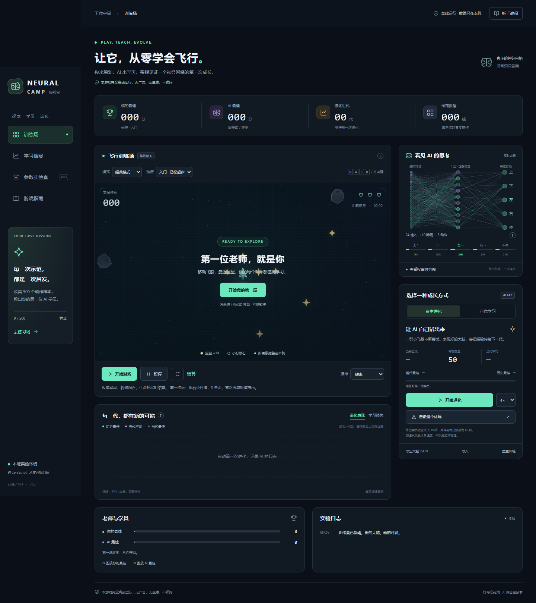

# 神经网络训练营

[在线试玩](https://kevinmasai.github.io/neural-camp/) · [下载源码](https://github.com/KevinMaSAI/neural-camp/archive/refs/heads/main.zip) · [测试说明](./测试说明.md) · [MIT 许可](./LICENSE)

点击「在线试玩」即可开始；下载 `index.html` 后双击也能离线游玩，无需安装、服务器或构建。

开一艘飞船收集星星、躲开陨石，再让一个真正的小型神经网络学着玩。你可以自己示范，也可以看一群随机大脑通过选择、交叉和变异逐代进化。

**本游戏完全离线运行，无广告、无追踪、不联网。** 页面没有广告弹窗、第三方 SDK、统计代码或远程资源。首次教学、游戏说明和成就提示都在页面内部显示，不打开新窗口。

## 立即开始

1. 用浏览器打开 `index.html`。Windows 可以直接双击；不需要安装软件包、运行命令或启动服务器。
2. 选「入门」难度和「经典」模式，开始游戏。
3. 用方向键或 WASD 移动。每颗星星加 10 分，存活每秒加 1 分。
4. 想放松练习就选「禅模式」；想看 AI 自学就开始进化；想教它你的打法就先玩，再用自己的示范训练。

整个应用的 CSS、JavaScript、SVG 图标都内嵌在 `index.html` 中。`README.md` 和 `LICENSE` 是说明文件，运行时不会加载它们。

## 操作

| 操作方式 | 用法 |
| --- | --- |
| 键盘 | 方向键 / WASD 控制方向；用 Tab 切换界面控件，用 Enter / 空格激活按钮 |
| 鼠标跟随 | 在操作方式中选择鼠标，再把指针移动到游戏区域内的目标位置 |
| 触屏拖动 | 在操作方式中选择触屏，在画布上拖动控制飞船 |
| 暂停 / 继续 | 主暂停按钮控制当前游戏、进化或模仿训练；两种训练面板也提供各自的暂停 / 继续按钮 |
| 重开 | 保存已进行的当前局，再重新开始当前玩法；也可以先点「结算」查看成绩 |
| 手动示范 | 开始自己玩，游戏会在本地记录状态与动作，无需额外录屏 |

飞船每一步采用上、下、左、右、不动中的一个动作；鼠标和触屏目标也会转成这五种动作，因此 AI 学到的是同一套操作。按键焦点在输入框或下拉菜单时，可以正常调整参数。支持手机窄屏、色盲友好配色与大字号。

## 难度

| 难度 | 适合谁 | 默认生命 | 陨石与辅助 |
| --- | --- | --- | --- |
| 入门 | 第一次玩、第一次给 AI 示范 | 3 | 陨石少且慢，星星较多，有目标提示和碰撞预警 |
| 普通 | 熟悉操作后正常挑战 | 2 | 标准数量与速度 |
| 困难 | 想练反应和走位 | 1 | 陨石更多、更快 |
| 极限 | 熟练玩家冲击高分 | 1 | 高速密集陨石，无辅助 |

难度可以随时切换。进行中的一局如果更改难度或游戏参数，会记为「混合规则」，保留生涯与回放，但不进入标准成绩比较。自定义参数可以覆盖默认游戏设置；每日挑战使用固定设置。

手动调整的星星数和生命数会保存，刷新后仍生效。普通玩法切换难度时，这两项恢复新难度默认值；自定义模式切换难度则保留你设定的星星数与生命数。

## 六种模式

| 模式 | 玩法与结算 |
| --- | --- |
| 经典 | 收集星星并躲避陨石。每次有效碰撞扣一条命，生命耗尽结束；单生命难度撞一次就结束 |
| 生存 | 没有星星，只比存活时间。生命耗尽结束 |
| 限时冲刺 | 最多 60 秒，尽量拿高分；到时或生命耗尽结算 |
| 禅模式 | 不会死亡，碰撞只弹开；适合练习和示范，用「结算」按钮结束 |
| 每日挑战 | 根据 UTC 日期生成固定种子，使用固定普通难度设置；60 秒或生命耗尽结算，记录自己的每日成绩 |
| 自定义 | 调整速度、陨石密度、陨石速度、星星数量和生命数，也可以保存并载入预设 |

存活越久，陨石压力越大。碰撞后会有短暂保护，避免一次重叠连续扣完生命。

每日挑战的日期按 UTC 计算，因此同一时刻全球玩家获得相同日期与种子。模拟采用固定 30 Hz 时间步，同一天的初始布局和随机生成规则一致；不同操作会使后续游戏状态不同。排行榜仅保存在当前浏览器，没有联网排名。

## 让 AI 学会玩

### 路线 A：神经进化

点开始进化，默认会生成 50 个随机神经网络。每个网络独立跑一局，实际游戏得分就是它的适应度。普通训练评估最长 30 秒，限时冲刺与每日挑战评估最长 60 秒；这个上限让不会死亡的禅模式也能完成一代。

每一代先保留少量优胜者，再通过锦标赛挑选父代：随机挑几位，比一比得分，胜者获得繁殖机会。后代把两个父代的权重混合，并随机给部分权重加上高斯噪声。下一代重新跑游戏评分，继续循环。

用 1× / 4× / 16× 调整进化推进速度，实际速度还受设备计算能力影响。曲线显示各代最佳与平均成绩，历史最佳记录当前训练环境中发现的最好大脑。点「看最佳个体玩」可以观察冠军实际动作及神经元激活。

**进步不是预设动画。** 权重起点、交叉与变异都具有随机性，每代平均分不保证上升，有限训练也不保证达到最优。相同评估环境下，保留的历史最佳成绩不会降低；切换游戏环境后需要重新评估，不能把不同参数下的成绩当成公平对比。

### 路线 B：模仿学习

自己玩时，应用按每秒 30 个模拟步骤记录状态特征与实际动作；暂停时不记录。至少收集 50 个样本才能启动训练，建议先积累 500 个以上。点「用我的示范训练」后，网络学习在类似情况下预测你会做的动作。训练面板显示交叉熵 loss（预测越接近示范动作，这个数通常越小）及动作准确率。

数据分成训练部分与留出评估部分。多局示范优先按整局隔离，最后约 20% 的局用于评估；只有一局或样本不足时，按先后切分为前约 80% 训练、后约 20% 评估，并在中间留出 10 帧间隔。准确率在未参与权重更新的留出样本上计算，最多评估最近 2400 个；训练 loss 为控制计算量也使用有上限的样本子集。

同一玩家相邻局面仍可能相似，因此这是教学用途的粗略指标，不能代表所有新局面的表现。最终效果要看 AI 在游戏中能否生存和收集星星。完成一次训练后再次开始模仿学习，会用现有示范和当前参数建立一个新的随机网络。

示范尽量包含向各方向移动、接近星星、绕开陨石和停下。只在原地站着，或者只往一个方向走，网络也会学到这种偏好。样本太少时很难学像；更多且多样的示范更有帮助。训练后可以再次手动玩一局，补充它不擅长的情况。

## 神经网络如何实现

### 前向传播

网络把画面压缩为 24 个数：最近 4 个陨石的相对位置与速度（16 个），最近 2 颗星星的相对位置（4 个），飞船的位置与速度（4 个）；缺少的对象填 0。每个隐藏神经元计算「输入乘权重后相加，再加偏置」，经过 ReLU、tanh 或 sigmoid 激活函数，传给下一层。默认有 1 个隐藏层、10 个神经元，使用 tanh；可以选 1～2 层，每层 4～24 个。最后输出 5 个动作的分数，softmax 把它们变成概率，最高概率动作驱动飞船。

### 神经进化

一个网络的全部权重和偏置可以拉成一串数字，这串数字就是可交叉、可变异的「基因」。系统根据真实游戏分数保留和繁殖个体，不使用预写的避障策略替代网络决策。网络结构变动后需要重新创建符合结构的大脑。

### 反向传播

模仿学习使用动作标签与 softmax 输出计算交叉熵，再从输出层往回计算每个权重对误差的影响。小批量随机梯度下降把一组样本的梯度取平均，以学习率指定的小步长更新权重。初始化、矩阵运算、激活函数及导数、前向传播、反向传播、SGD、交叉与变异全部是手写 JavaScript，没有机器学习库。

## 面板、进度与保存

- **大脑结构图**：节点亮度表示激活值；连线颜色表示权重正负，粗细表示绝对值。
- **权重热力图**：把某一层的权重排成矩阵，用色块观察它们的分布。
- **训练曲线与日志**：查看每代最佳 / 平均适应度、模仿 loss 以及训练进度。
- **玩家 vs AI**：按当前模式、难度与实际生效的参数显示成绩，中途改规则的局不混入标准比较；进化试飞有评估时限，完整手动 / AI 飞行可能更长，因此数字不是严格统一时长的比赛排名。
- **历史与生涯**：查看最近 30 局、已结算的手动和 AI 飞行次数与总得分、累计示范量、AI 成长和成就。进化内部每个个体的评估不计入飞行局数，另记入成长曲线。
- **成就**：包括手动达到 100 分、坚持到冲刺 / 每日计时结束、同规则下 AI 超过你非零的最佳分、进化到第 10 代、累计示范 500 条。「极限领航员」要求在经典 / 生存 / 冲刺的标准极限规则下手动达到 500 分，整局不修改规则；禅、自定义与增加生命等设置不计入该成就。
- **参数**：游戏参数控制体验；网络参数控制大脑结构；进化参数控制种群与遗传；模仿参数控制学习率、小批量大小与训练轮数。参数变更会暂停旧进化实验，必须点「开始进化」建立新实验，主暂停按钮不会绕过这一要求恢复旧种群。
- **预设**：保存当前参数，在自定义模式中重新载入。
- **回放**：按玩家 / AI 来源、模式与实际规则分别保存最佳局，总共保留最近 16 条。点击回放时优先匹配当前规则；没有对应记录，就显示该来源最近保存的最佳局并提示。回放用原种子、每秒 30 步的动作序列以及当局参数 / 难度变更，重新运行相同模拟；不是视频，也不是逐帧画面截图。回放不会再次更新分数或示范样本。最多完整记录 108000 步，相当于 1× 速度下 60 分钟；超长局仍可结算，但不会替换已保存的完整回放。

最佳分数、成就、设置和可保存进度使用 `localStorage` 留在当前浏览器。浏览器可能因隐私模式、存储空间限制、清除站点数据或 `file://` 文件位置变化而无法保存或找不到旧记录；页面仍可游玩。换浏览器、换设备、移动 HTML 文件或改用 GitHub Pages 不会自动同步数据。

运行中的示范内存上限为 12000 条，超过上限时移除最旧的 1000 条；自动保存保留最近 6000 条。因此「当前样本数」与不会因样本淘汰而减少的「累计示范量」不同。保存通常每 15 秒发生一次，结算和离开页面也会尝试保存。

保存会保留冠军、最近完成训练轮的大脑以及曲线。刷新后可直接让已保存的大脑演示；重新开始进化会建立新种群，如果冠军与当前环境及网络结构兼容，会把它放入种群的一个位置，其余个体重新随机初始化。未完成的一代、整个种群状态和模仿训练的批次进度不会原样恢复。「重置训练」需要在页面内再次点击确认，会清空当前大脑与训练曲线，保留示范、成绩和生涯记录。

训练好的网络可以导出为 JSON，之后通过导入恢复。文件最大 1 MB；导入检查网络版本、层数、维度、激活函数与有限数值，不执行文件中的代码。导出含权重、偏置和参数快照；导入加载大脑本身，不自动套用导出时的游戏 / 训练参数。建议训练出满意的大脑后导出备份；这不是完整生涯备份，不包含示范样本、回放、种群或训练批次进度。

## 部署到 GitHub Pages

本地游玩完全不需要 GitHub。想分享网址时再执行：

1. 在 GitHub 新建仓库，把 `index.html`、`README.md`、`LICENSE` 上传到仓库根目录并提交。不要只上传一个里面另有 `outputs` 的空外层目录。
2. 打开仓库 **Settings → Pages**。
3. 在 **Build and deployment → Source** 选择 **Deploy from a branch**。
4. 选择包含文件的分支（通常为 `main`），目录选择 **/(root)**，保存。
5. 等待 GitHub 部署完成，使用 Pages 页面给出的站点网址。

无需 npm、打包或自行编写构建工作流。可以额外在仓库根目录放一个空 `.nojekyll` 文件，表明直接发布静态文件。仓库可见性和 Pages 权限取决于你的 GitHub 账户。步骤来源：[GitHub 官方 Pages 发布源说明](https://docs.github.com/en/pages/getting-started-with-github-pages/configuring-a-publishing-source-for-your-github-pages-site)。

访问分享网址需要下载页面；加载完后，游戏本身不再发出网络请求。要保证断网后重新打开仍可用，请保存并双击本地 `index.html`。本项目没有 Service Worker，不承诺浏览器自动缓存一个从未保存的远程页面。

## 可复现验收清单

下面是可在你的设备上重复的手动验证步骤。开发期间的算法、模拟测试和 45 项 Edge 浏览器验收结果见 `测试说明.md`；尚未在真实手机、Safari、Firefox 或已发布的 GitHub Pages HTTPS 站点上验证。

- [ ] 断开网络，双击 `index.html`，页面正常显示，新手引导可完成或跳过。
- [ ] 在入门经典模式收集星星，检查每颗星星 +10 分、存活每秒 +1 分；碰撞扣生命，零生命结算。
- [ ] 依次进入六种模式；生存无星星，限时冲刺计时结束，禅模式可主动结束，每日日期与种子可见，自定义设置有效。
- [ ] 依次试四种难度，比较生命、星星和陨石压力；极限模式无辅助。
- [ ] 分别用键盘、鼠标和触屏操作，暂停后计时停止，继续后恢复；窄屏控件可操作。
- [ ] 开始进化，等待完成数代；检查实际成绩、适应度曲线和日志更新，再让最佳个体实际游玩。
- [ ] 手动积累示范样本，启动模仿训练；检查 loss、留出准确率与训练后动作。多次训练可能出现波动，不把单次上升当故障。
- [ ] 改动网络结构与训练参数，再重新训练，确认新设置进入训练；保存预设并在自定义模式载入。
- [ ] 检查大脑图、热力图、比较条、最近分数、生涯和成就；刷新后确认本地保存的数据仍在。
- [ ] 导出大脑 JSON，再导入并运行；导入损坏 JSON 应显示错误且页面继续可用。
- [ ] 播放最佳回放，确认不会增加游戏局数、总分或示范样本。
- [ ] 用 Tab / Enter 操作界面，切换色盲配色与大字号，打开规则和教程。
- [ ] 打开浏览器开发者工具的 Network 面板，清空记录，操作游戏与训练，确认没有外部请求；Console 无应用错误。
- [ ] 部署后在桌面和手机浏览器打开 Pages 网址；同时保留本地文件，验证 `file://` 和 HTTPS 两种打开方式。

## 开源许可

采用 MIT 许可证，见 `LICENSE`。允许复制、修改和再分发，包含商业使用；分发时保留版权和许可声明。
